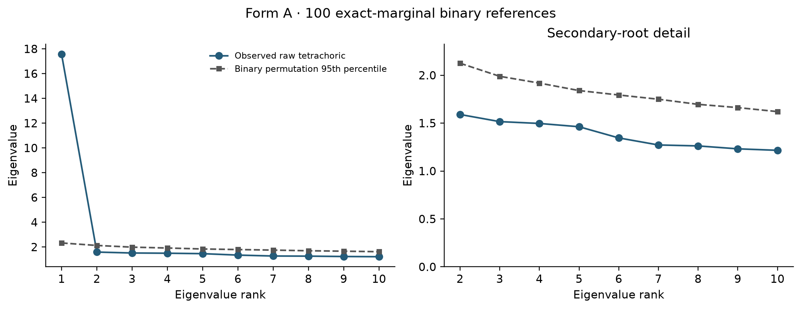
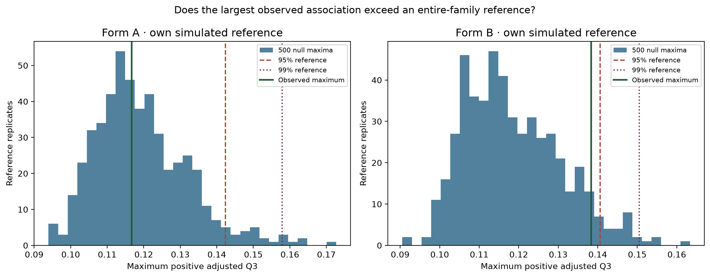
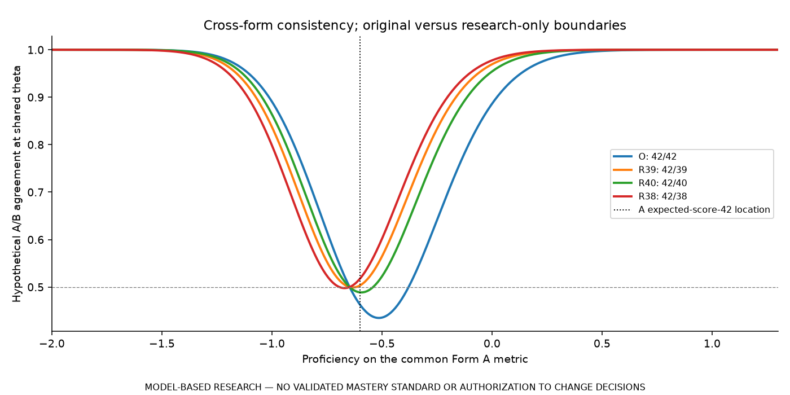

# Curated figures and interpretation

These are unchanged copies of existing approved audit figures. They were inspected visually before selection. Original/staged hashes are recorded in [file provenance](../docs/FILE_PROVENANCE.csv). The synthetic setting and limitations below accompany the figures; they should travel with any later approved reuse. [E01]

## Dimensionality: primary Form A binary parallel analysis

**Context:** first observed Form A complete cases, all operational items. Raw tetrachoric eigenvalues are compared with 100 exact-marginal binary permutation references and their order-matched 95th percentile; the secondary panel enlarges smaller roots. This supports a dominant-dimension investigation, not the true number of competencies. The raw matrix's numerical inadmissibility and the separate EFA conditioning remain relevant. [MP03] [E03]

**Source:** Stage 3 original figure `parallel_analysis_form_A.png`; [parallel-analysis values](../results/stage3/parallel_analysis_results.csv), [matrix diagnostics](../results/stage3/correlation_matrix_diagnostics.csv) and [protocol](../analysis/configs/STAGE3_CONFIG.json).

## Residual dependence: separate fixed-calibration references

**Context:** first attempts within each form, saved signed models, fixed observed missing masks and 500 simulated null maxima per form. Green is the observed maximum; dashed/dotted marks are the 95%/99% references. Each panel has its own within-form family. No pair exceeded the primary family-wise screen; this does not establish independence. Form B remains close to its screening boundary, and the reference omits item-estimation uncertainty. [MP05] [E04]

**Source:** Stage 5 original figure `q3_null_reference_by_form.png`; [retained maxima](../results/stage5/q3_null_distribution.csv), [thresholds](../results/stage5/q3_familywise_thresholds.csv), [simulation completion](../results/stage5/simulation_completion.csv) and [protocol](../analysis/configs/STAGE5_CONFIG.json).

## Decision behavior: conditional A/B agreement

**Context:** hypothetical independent A/B administrations at the same unchanged proficiency under the primary provisional S18 Stocking-Lord link. O is the original A/B 42/42 rule. R39, R40 and R38 are research-only A/B 42/39, 42/40 and 42/38 sensitivities, never recommended passing standards. The vertical reference is where A's modeled expected score equals 42; it is not an observed-score group or validated mastery location. This is a conditional curve, not a population-integrated estimate, observed retest result or accuracy curve. Alternative boundaries were not selected to maximize agreement. [MP09] [Q20]

**Source:** Stage 9 original figure `cross_form_agreement_by_theta.png`; [all plotted curve data](../results/stage9/cross_form_agreement_by_theta.csv), [original and research reference locations](../results/stage9/near_cut_classification_uncertainty.csv) and [protocol](../analysis/configs/STAGE9_CONFIG.json). Parameter/link uncertainty is retained separately in the result tables and is not shown as zero by its absence from this point-estimate figure.

All plotted labels/axes were reviewed for legibility. These are explanatory retained PNGs, not newly estimated evidence. The approved executive PDFs remain separately available in [reports](../reports/README.md).

[E01]: ../docs/claims.md#e01
[E03]: ../docs/claims.md#e03
[E04]: ../docs/claims.md#e04
[MP03]: ../docs/claims.md#mp03
[MP05]: ../docs/claims.md#mp05
[MP09]: ../docs/claims.md#mp09
[Q20]: ../docs/claims.md#q20
